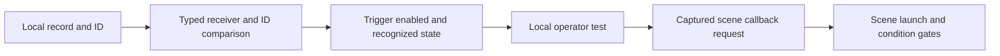

# MyHOMEServer1 3.87.13 Local Event Triggers

The selected `BNIL` and `BNLD` triggers convert local state comparisons into requests to launch their captured scene. Their schema, operators and local type numbers belong to the scheduler in [MyHOMEServer1 Firmware 3.87.13](myhomeserver1-3.87.13.md); the names are not public WHO values or evidence of a particular physical function.

## Schema and object identities

The raw trigger factory and compiled initializer use separate dispatch tables. `BNIL` is raw trigger row `1`; its raw `BnilTrigger` is `44` bytes and its compiled `BnilTriggerRunner` inner object is `64` bytes. Its inherited fields have the following selected representations:

| Field | Raw offset | Compiled-inner offset |
| --- | ---: | ---: |
| `id` string | `4` | `24` |
| Enabled byte | `28` | `48` |
| Local type word | `32` | `52` |
| Local operator word | `36` | `56` |
| Configured status word | `40` | `60` |

The schema maps operator names `noOperator`, `higher`, `lower`, `equal`, `different` to local `-1`, `0`, `1`, `2`, `3`, and status `noStatus`, `on`, `off` to `-1`, `0`, `1`. Its serializer and reparse use the same JSON destination under normal object/member/provider assumptions. These local values are separate from scene state, action completion and wire semantics. [Schema evidence](../../project/review/firmware-analysis/myhomeserver1-3.87.13-event-trigger/schema-report.txt) identifies the actual raw/final classes and serializer.

## Callback capture and local publication

The initializer captures its scene pointer in the callable and copies it to the persistent runner. The copy manager copies a raw pointer; it does not locally retain/release an owning scene reference. The trigger/control pair enters the scene's compiled trigger range.

The runner's callable method differs from its nonvirtual admission handler and cleanup methods. Its stored invoker reaches the scene's normal launch function, whose enabled/active, condition and action gates remain further boundaries. [Callback evidence](../../project/review/firmware-analysis/myhomeserver1-3.87.13-event-trigger/registration-report.txt) records publication and capture identity.

## Local event admission

The diagram describes conditional source relations, not a captured event or accepted external frame. The selected caller casts the trigger receiver, compares its ID with the supplied ID, then passes an embedded state string to the admission handler. The [local record producer](myhomeserver1-3.87.13-event-routing.md) supplies a selected upstream route; complete external subscription and input admission remain unresolved.

The `BNIL` handler first requires its own enabled byte, then recognizes exact lowercase `on`, `off` and `noStatus`. Other selected strings return without requesting the callback.

| Local operator | Selected admission after recognized state |
| ---: | --- |
| `2` | Event value equals configured status |
| `3` | Event value differs from configured status |
| Other words | Reach the selected callback request without either equality test |

There is no ordered higher/lower comparison in this handler. Its fallthrough does not establish an accepted public operator grammar. The handler stores no prior event value locally; change detection or deduplication elsewhere remains unresolved. [Admission evidence](../../project/review/firmware-analysis/myhomeserver1-3.87.13-event-trigger/admission-report-v2.txt) retains the exact calls and guards.

## Ownership and remaining boundaries

The selected caller copies trigger handles into a temporary vector, increments nonzero controls, then releases those copies before later ID/handler use. Continued receiver lifetime depends on the scene vector or other owners. Actual caller ordering, errors/unwind and concurrency remain unresolved; neither adequate lifetime nor a failure is established.

## BNLD numeric trigger

`BNLD` is a distinct trigger at row `3`, not the [condition at row `2`](myhomeserver1-3.87.13-event-routing.md#distinct-bnld-condition). Its raw object is `48` bytes and compiled inner object `68` bytes. On the selected absent-`status` route, status and level begin as `-1`; `level` supplies an `asInt` result. A positive level writes status `-1` again, so that store does not exclude positive thresholds. [Trigger serialization](myhomeserver1-3.87.13-trigger-serialization.md) describes the same-result reparse contract.

The selected caller matches class and ID, requires configured status `-1`, a suitable record's integer word `32` different from `-1`, and exact record state `on`, then passes that integer to the handler. This integer is not the Thermostat record's independently typed double at the same numeric offset.

The handler requires enabled, then uses signed comparison:

| Local operator | Selected callback request |
| ---: | --- |
| `0` | Supplied integer greater than configured threshold |
| `1` | Supplied integer less than configured threshold |
| `2` | Supplied integer equals configured threshold |
| `3` | Supplied integer differs from configured threshold |
| Other words | Reach the selected callback branch without these comparisons |

The initializer captures a raw scene pointer and publishes the persistent trigger handle. The selected admission can therefore request that scene's launch, without establishing an owning capture, a valid configured scene, active subscription, satisfied conditions or completed actions. As with `BNIL`, copied temporary controls are released before later receiver use. [Numeric-trigger evidence](../../project/review/firmware-analysis/myhomeserver1-3.87.13-numeric-trigger/README.md) identifies the independent class, caller, comparison direction and lifetime premises.

The handler receives a single supplied value. Threshold crossing, previous-value state, hysteresis, deduplication, physical units, permitted numeric domains and natural event delivery remain unresolved. The findings are static implementation evidence, without a complete trigger transaction or Physical Device observation.
