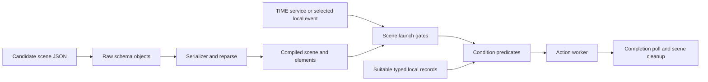

# MyHOMEServer1 3.87.13 Scenario Engine

MyHOMEServer1's examined scenario engine loads JSON scene descriptions, constructs raw elements and compiles them into trigger, condition and action objects. Time and selected local-event paths request scene launch; conditions gate action execution; scene cleanup, action completion and cancellation are separate states. This is a build-specific implementation map, not an executed configured scene or a replacement for the published OpenWebNet model.

## Product and build scope

The [Device definition](../../devices/definitions/own-dev-0199-myhomeserver1-home-automation-server.md) establishes MyHOMEServer1's SCS/Ethernet home-automation and app-commissioned scenario role. [Firmware 3.87.13](myhomeserver1-3.87.13.md) identifies the manufacturer package and component sources. Its ARM hard-float C++ layouts were derived independently; shared labels do not transfer F454 AV/alarm hardware, MH202 script semantics or another build's offsets.

| Topic | Canonical build-specific reference |
| --- | --- |
| Catalogue and JSON file consumption | [Consumers](myhomeserver1-3.87.13-consumers.md) and [factories](myhomeserver1-3.87.13-factories.md) |
| Main, settings, time-service and numeric registry identity | [Startup and scene registry](myhomeserver1-3.87.13-startup.md) |
| TIME and local-event launch paths | [TIME scenarios](myhomeserver1-3.87.13-time-scenarios.md) and [event triggers](myhomeserver1-3.87.13-event-trigger.md) |
| Typed cache and condition predicates | [Event routing and conditions](myhomeserver1-3.87.13-event-routing.md) |
| Execution, waits, cancellation and lifetime | [Actions](myhomeserver1-3.87.13-actions.md), [cancellation](myhomeserver1-3.87.13-cancellation.md) and [worker lifetime](myhomeserver1-3.87.13-lifetime.md) |
| Serialization, retained owners and disposal | [Serialization and ownership](myhomeserver1-3.87.13-serialization.md) |
| Local action interface and selected values | [Handoff](myhomeserver1-3.87.13-action-output.md), [request values](myhomeserver1-3.87.13-action-request-values.md) and [retained state](myhomeserver1-3.87.13-action-retained-state.md) |

## Scene construction and launch

Arrows represent conditional source relations. Valid objects, normal providers, appropriate IDs/types and lifetime remain premises at their boundaries.

Main supplies a scene container and time-service instance to the loader. The loader selects candidate JSON paths, parses them and constructs separate trigger/condition/action objects. A nested `SCENARIO` action captures the same first registry tree used by loading. Numeric ID conversion, one category-specific allocator and local duplicate refusal are traced; they are not a universal external ID grammar or file-order policy.

The selected launch functions test scene enabled and active state. A condition worker stops at the first zero predicate; all nonzero or empty conditions can reach the action worker. Trigger/action vectors store pointer/control pairs, whereas the condition range stores compiled-object pointers with an independently traced deleting cleanup path. The representation difference alone establishes neither absent ownership nor safe lifetime.

## Trigger and condition behavior

| Element | Selected implementation | Material unresolved boundary |
| --- | --- | --- |
| `TIME` trigger | Weekday map, service registration, deadline arithmetic and captured scene callback | Complete input/clock/timezone/DST/error policy and actual scheduling |
| `TIME` condition | Disabled passes; enabled checks day and strict local-time boundaries, with equal bounds passing | Configured input, clock validity and provider outcomes |
| `BNIL` trigger | Enabled/ID/recognized-state admission; equality/difference operators and other-word fallthrough | Natural external subscription, admitted operator grammar and receiver lifetime |
| `BNLD` trigger | Own signed threshold comparisons, guarded integer record and captured-scene request | Complete JSON admission, suitable fresh record and physical meaning |
| `BNLD` condition | Separate status-versus-level schema and predicate | Suitable cached/query record, full member coherence and response correlation |
| `BNTH` condition | Selected double-setpoint serialization/equality path and typed record producer | Other schema branches, type/ID/freshness, units and physical measurements |
| `BNCUSCENE` condition | Entire predicate XORs its enabled byte with `1`; ordinary enabled `1` returns `0` | Configured instantiation, other methods/mutations and intended feature meaning |

These private names and enum values are not a public command-support table. The BNCUSCENE result supports neither a product-wide unsupported-feature declaration nor a defect claim. Numeric-trigger [serialization](myhomeserver1-3.87.13-trigger-serialization.md) preserves the selected threshold/status relation under ordinary JSON/provider premises, without a universal lossless round trip.

Light and Thermostat record layouts are independently typed. Their equal numeric field offset does not make an integer level and double setpoint interchangeable. A producer's default double zero is a software default, not a physical measurement or missing-device diagnosis. Event `params.id` differs from removal `params.scene_id`.

## Local action requests

`SLEEP` and `SCENARIO` compile to distinct callables. Selected BN3L callables use independent captures and construct local `jsonrpc`, `method`, `id` and `params` objects for a common helper. The descriptor requests version `2.0` and method `light.setStatus`; its outer UUID-derived request ID differs from captured target `params.id`. A selected positive signed word supplies `params.speed`.

A first query and second callable share fixed global retained storage. With a suitable returned `on` string, no incompatible intervening mutation and normal providers, a selected second branch requests parameter `status: on`. Complete payloads, fresh same-ID correlation, natural paired order, delivery and physical rollback remain unresolved.

## Timing, cancellation and lifetime

SLEEP's selected blocking callable requests whole seconds. Common operational waits use a separately derived nominal scale of `60` seconds. JSON metadata, operational delay and duration must be traced through their own setters: one BN3L path binds duration and a second callable, while the selected SLEEP construction keeps duration metadata separate.

| State or owner | Consequence |
| --- | --- |
| Scene stop/active | Cleanup can clear both after leaving completion polling |
| Individual action completion | Scene cleanup does not set it or establish worker completion |
| Shared action cancellation | Selected action stops set a common flag; scene-byte clearing is not its reset |
| Thread-state receiver | Raw pointer; state disposal is not proof of receiver survival |
| Detached holder | Its word can clear before the worker finishes |
| Registry/vector owners | Retain/release and disposal requests are traced; natural last-owner and concurrent ordering remain unresolved |

A numeric scene-removal caller clears its stored pair before releasing and erasing the node. Its local key provenance is known, but its supplied context has not been equated with startup's registry. No positive runtime reset owner for the shared action flag is established. These limits do not themselves prove a race, leak, permanent latch or failed restart.

## Catalogue consumption

The embedded catalogue is a separate source profile. Its table definitions match Suite's, but one index and `33` complete table row multisets differ. [Catalogue profiles](../../internals/mhcatalogue-source-profiles.md) distinguish retained owners, omitted/embedded-only records, reused IDs and equivalent renumbered fields. Filename or integer equality is insufficient for a cross-source join.

Compiled opening calls and a selected `15`-column query connect source-owned slots and system IDs to an actual consumer. Complete Device/Firmware selection and fallback remain unresolved. The profile's omission of MyHOMEServer1's own item also prevents interpreting it as a complete self-capability inventory.

## Evidence classes

Most findings are static source or read-only database evidence. One isolated packaged JsonCpp experiment constructs and reads back the same scalar object for positive zero, negative zero, negative one and `1.25`, preserving returned bits including signed zero. It does not execute full JSON member/map/assignment/reparse or the BNTH predicate. The [scalar experiment](myhomeserver1-3.87.13-serialization.md#isolated-original-scalar-constructor-and-readback) links its exact setup and saved accounting.

No complete MyHOMEServer1 scene, target process/service, active clock/thread/timer environment, network/bus transaction or physical action is established by this implementation map.

## Evidence limits

The [source and review collection](../../project/review/firmware-analysis/myhomeserver1-3.87.13-synthesis/README.md) retains original identities and historical interpretations. Linked topic records hold the exact bytes, method locations, conditional source claims and experiment details.

Populated scene/generator assets, actual input admission and delivery, effective provider/type/readiness, query correlation, shared reset ownership and natural owner/poll/removal order remain unresolved. Referenced extras `80/81/94/95` are missing from the download. Complete errors/unwind, concurrency and physical validation require separate evidence.
